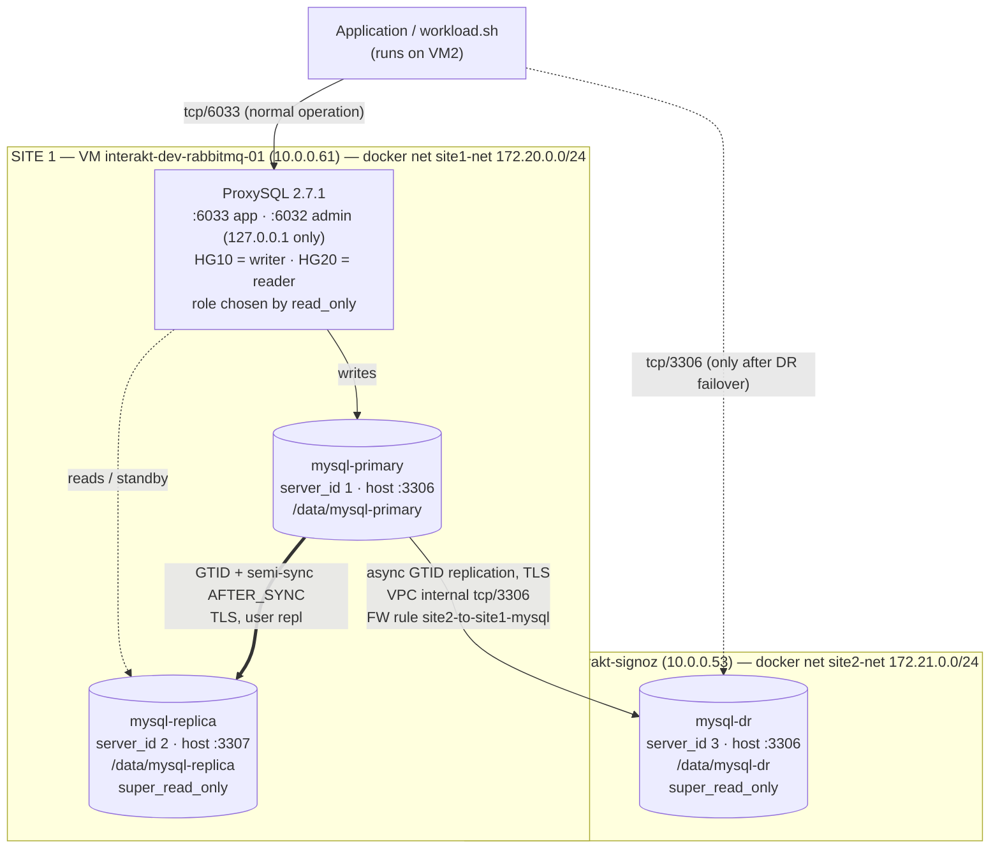

# Architecture

## Diagram



Text version (same thing, for terminals):

```
                    ┌──────────── SITE 1 · interakt-dev-rabbitmq-01 · 10.0.0.61 · site1-net ────────────┐
 app (VM2) ─6033──► │ ProxySQL ──HG10──► mysql-primary :3306 ══semi-sync AFTER_SYNC══► mysql-replica :3307 │
                    │          └─HG20──► mysql-replica                                                     │
                    └───────────────────────────────┬──────────────────────────────────────────────────┘
                                                    │ async GTID, TLS, VPC tcp/3306
                    ┌──────────── SITE 2 · interakt-signoz · 10.0.0.53 · site2-net ─────────────────────┐
                    │ mysql-dr :3306  (super_read_only, promoted manually)                               │
                    └──────────────────────────────────────────────────────────────────────────────────┘
```

## Port map

| Host | Host port | Container | Who connects |
|---|---|---|---|
| 10.0.0.61 | 3306 | mysql-primary:3306 | DR replication (normal), admin |
| 10.0.0.61 | 3307 | mysql-replica:3306 | DR replication after a local failover |
| 10.0.0.61 | 6033 | proxysql:6033 | application |
| 127.0.0.1 (VM1) | 6032 | proxysql:6032 | ProxySQL admin, local only |
| 10.0.0.53 | 3306 | mysql-dr:3306 | application after DR failover; Site 1 during failback |

## How Site 2 reaches Site 1

1. `mysql-dr` (172.21.0.x) opens a connection to `10.0.0.61:3306`. Docker NATs it out of VM2's interface `10.0.0.53`.
2. The packet crosses the VPC `interakt-development-vnet` (both VMs are in the same subnet, zone `asia-south1-a`).
3. GCP ingress rule **`site2-to-site1-mysql`** allows `tcp:3306,3307,6033` from `10.0.0.53/32` to instances tagged `mysql-site1`.
4. Docker on VM1 forwards host port 3306 to `mysql-primary:3306`.
5. Replication authenticates as `repl` (only `REPLICATION SLAVE`, `REQUIRE SSL`) and runs over TLS (`SOURCE_SSL=1`; MySQL auto-generated certificates).

The reverse rule **`site1-to-site2-mysql`** (`tcp:3306` from `10.0.0.61/32` to tag `mysql-site2`) exists for failback and clone.
Public IPs are never used; MySQL is not reachable from the internet. Docker-published ports bypass `ufw`, so the GCP firewall is the control.
Evidence: `docs/evidence/screenshots/01-firewall-rules.png`, `07-task2-site2-to-site1-connectivity.png`, `08-task2-dr-replication-status.png`.

## Design decisions

**MySQL 8.4 LTS (8.4.11).** 8.0 reached end of life in April 2026; 8.4 is the supported long-term release. 8.4 syntax is used throughout (`CHANGE REPLICATION SOURCE`, `SHOW REPLICA STATUS`, `RESET BINARY LOGS AND GTIDS`, `--source-data`).

**Async replication + semi-sync + ProxySQL instead of Group Replication / InnoDB Cluster.**
The brief asks for one primary and one replica in Site 1. Group Replication needs a majority to accept writes, so a two-member group cannot survive losing either member — it would need a third Site 1 node. Classic replication with semi-sync gives the property the brief asks for ("an acknowledged write exists on more than one node") with exactly two nodes, and the failover steps are explicit and easy to reason about.

**Semi-sync `AFTER_SYNC` (lossless), timeout 10 s.** The primary writes the binlog, waits for the replica to confirm it has the event in its relay log, and only then commits and answers the client. An acknowledged write therefore always exists on two nodes. If the replica is gone for more than 10 s the primary falls back to async rather than blocking all writes: availability is preferred over durability during a double fault, and the fallback is alerted on (`Rpl_semi_sync_source_status = OFF`, see `monitoring.md`).

**DR is asynchronous.** Semi-sync to another site puts the inter-site round trip on every commit, and any Site 2 or WAN problem would stall Site 1 writes until the timeout. Site loss is rare; a small, measured RPO is accepted instead of coupling primary latency and availability to a remote site. `mysql-dr` loads the semi-sync plugin but never enables it, so it never acknowledges (`Rpl_semi_sync_source_clients` stays `1`).

**DR replicates from the Site 1 primary, not from the replica.** It keeps the DR copy one hop from the source (lowest lag) and does not depend on the replica being healthy. Cost: after a local failover DR must be re-pointed (one `CHANGE REPLICATION SOURCE`; GTID auto-positioning makes it safe).

**GTID auto-positioning everywhere.** Re-pointing a replica to any other node is one statement, with no binlog file/position arithmetic, and errant transactions can be detected with `GTID_SUBTRACT`.

**ProxySQL `mysql_replication_hostgroups` with `check_type=read_only`.** ProxySQL polls `read_only` every second; whichever backend is writable is placed in writer hostgroup 10. Promoting a replica is just "make it writable" — the application keeps using `10.0.0.61:6033` and needs no change. Measured: the promoted node appeared in HG10 within the same poll cycle.

**Every node boots read-only (fencing).** `super_read_only=ON` is persisted with `SET PERSIST` on every node; the primary is made writable only with `SET GLOBAL`. A crashed primary that restarts, or a whole site that comes back after a DR failover, can never accept writes on its own. Observed in Test 2: when Site 1 came back, both nodes were read-only and ProxySQL had no writer (`docs/evidence/test2-site1-returned-readonly.txt`).

**Role settings in SQL, identity in files.** The `.cnf` files are identical except `server_id`/`report_host`; semi-sync on/off and read-only are runtime/persisted settings. Roles move during failover without editing files, and the Docker entrypoint's first-boot init is not broken by `super_read_only`.

**Data outside the containers.** Each datadir is a host bind mount under `/data` on the VM, so containers can be killed, removed or upgraded without data loss. (It is on the VM root disk — see `assumptions.md`.)

**Clone plugin loaded on all nodes.** Rebuilding a replica that has errant transactions or is too far behind is a single `CLONE INSTANCE` from a healthy node, with no external tooling.

**Replication user least privilege.** `repl`: `REPLICATION SLAVE` only, TLS required. `monitor`: `REPLICATION CLIENT` only. `app`: DML on `appdb` only.
